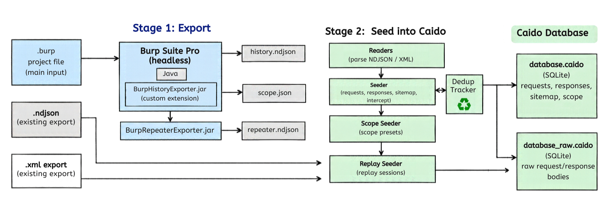

# burp-caido-syncer

Migrate Burp Suite proxy history, scope, and Repeater tabs into Caido, optimised for large Burp projects. No re-sending of requests.

## Architecture



Two stages:

1. **Exporter** -- A Burp Montoya extension that dumps `proxy().history()`, target scope, and Repeater tabs to NDJSON. The CLI drives Burp headless; the extension is a thin API adapter.
2. **Seeder** -- A Python CLI that reads the NDJSON (or legacy Burp XML) and batch-inserts into Caido's SQLite databases, including the sitemap tree, scope presets, and Replay sessions.

## Demo

<p align="center">
  
</p>

## Requirements

| Requirement | Version |
|---|---|
| Python | 3.10+ |
| JDK | 17+ (for building the exporter) |
| Burp Suite Professional | Valid licence |
| Caido | Installed ([Linux](https://docs.caido.io/quickstart/beginner_guide/setup/linux), [macOS](https://docs.caido.io/quickstart/beginner_guide/setup/mac), [Windows](https://docs.caido.io/quickstart/beginner_guide/setup/windows)) |

## Installation

```bash
git clone https://github.com/yourusername/burp-caido-syncer.git
cd burp-caido-syncer
python install.py
```
## Important: Create Your Caido Project First

> **You must create the target project in Caido manually before running the import.**
>
> Open Caido, create a new project, then close Caido before running the syncer. The tool writes directly to Caido's SQLite databases, so Caido **must not be running** during import.

## Quick Start

### Full import from a .burp project

```bash
burp-caido-syncer import project.burp --project-name "pentest-2024"
```

This runs Burp headless, exports proxy history to a temp NDJSON, and seeds it into the named Caido project. Add `--all` to pull scope and Repeater tabs in one pass:

```bash
burp-caido-syncer import project.burp --project-name "pentest-2024" --all
```

### Import pre-exported NDJSON

```bash
# Into a named project
burp-caido-syncer import history.ndjson --project-name "pentest-2024"

# Into the most recently used project
burp-caido-syncer import history.ndjson

# Into a specific project by UUID
burp-caido-syncer import history.ndjson --project 0b34647c-9796-45c8-a276-09c072f4d765
```

### Legacy XML

```bash
burp-caido-syncer import export.xml --format xml --project-name "from-xml"
```

### Standalone subcommands

```bash
burp-caido-syncer replay repeater.ndjson --project-name "pentest-2024"
burp-caido-syncer scope scope.json --project-name "pentest-2024"
burp-caido-syncer projects          # list Caido projects
burp-caido-syncer check             # run health checks
```

Set `--heap 8G` for large Burp projects (default 4G).

## What Gets Imported

| Burp | Caido |
|---|---|
| Raw request/response bytes | `requests_raw.data` / `responses_raw.data` |
| Host, port, TLS, method, path, query | `requests.*` |
| Status code, response length | `responses.*` |
| Original timestamp | `requests.created_at` |
| Round-trip time | `responses.roundtrip_time` |
| Highlight colour | `requests_metadata.color` |
| URL tree | `sitemap_entries` |
| Intercept entries | `intercept_entries` |
| Target scope rules | `scope_presets` |
| Repeater tabs | `replay_sessions` + `replay_session_entries` |

## Performance

WAL mode, 10k-row batched transactions, in-memory sitemap cache. A 5 GB project with ~50k requests imports in under 2 minutes. Disk I/O on the raw blobs is the bottleneck.

## Safety

- Caido must be closed during import (enforced unless `--force`).
- Existing projects are backed up before modification (skip with `--no-backup`).
- `--project-name` with a fresh project is the safest path -- no risk to existing data.

## Cross-Platform Support

| Platform | Caido data directory |
|---|---|
| Linux | `~/.local/share/caido/` (or `$XDG_DATA_HOME/caido/`) |
| macOS | `~/Library/Application Support/caido/` |
| Windows | `%APPDATA%\caido\` |

Override with `CAIDO_DATA_DIR`, `BURP_JAR`, or `MONTOYA_JAR` environment variables.

## License

MIT
